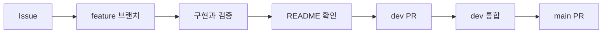

# Ipgo Client

Ipgo 서비스의 사용자 화면과 클라이언트 동작을 관리하는 React 애플리케이션입니다.
풀필먼트 수불부를 바탕으로 다음 입고 수량과 판단 근거를 제공하는 화면을 만듭니다.

## 실행 환경

| 항목            | 기준                         |
| --------------- | ---------------------------- |
| Node.js         | 24 LTS                       |
| 패키지 관리자   | npm 11                       |
| 화면            | React + TypeScript           |
| 개발 서버·build | Vite                         |
| Router          | React Router Data Mode       |
| 서버 데이터     | TanStack Query               |
| Form·검증       | react-hook-form + Zod        |
| 스타일          | CSS Modules + CSS 변수 token |
| Mock API        | MSW                          |

## 시작하기

```bash
nvm use
npm ci
npm run dev
```

개발 서버는 기본적으로 `http://localhost:5173`에서 실행됩니다. 로컬 `.env`가 없으면 환경
변수 설명에 있는 이름으로 파일을 만들고 공개 가능한 값만 설정합니다.

### 시험 계정

| 항목     | 값             |
| -------- | -------------- |
| 이메일   | `seller@a.com` |
| 비밀번호 | `pass1234`     |

회원가입을 시험할 때 이메일 인증 코드는 항상 `482915`입니다. 가입한 계정은 MSW 메모리에만 있어
브라우저를 새로고침하면 시험 계정만 남습니다.

로그인 상태는 앱을 시작할 때 `GET /auth/me`(A4)로 확인합니다. 서버는 세션 쿠키와 CSRF 토큰을
사용하므로, 변경 요청(POST 등)에는 `GET /auth/csrf`로 받은 토큰을 헤더에 넣습니다.
`shared/api/client.ts`가 자동으로 처리하고, 로그인·로그아웃 뒤에는 토큰을 다시 받습니다.
로그인은 form 방식으로 보내고 성공(204) 뒤 `/auth/me`로 사용자 정보를 받습니다. MSW의 인증 mock
(`src/auth/mocks/handlers.ts`)도 같은 규칙을 따릅니다.

## 명령

| 명령                      | 설명                                |
| ------------------------- | ----------------------------------- |
| `npm run dev`             | 개발 서버 실행                      |
| `npm run build`           | TypeScript 검사 후 production build |
| `npm run typecheck`       | TypeScript 검사                     |
| `npm run lint`            | ESLint 검사                         |
| `npm run format:check`    | Prettier 형식 검사                  |
| `npm test`                | Vitest 테스트 1회 실행              |
| `npm run test:watch`      | Vitest watch 실행                   |
| `npm run ci:check`        | CI에서 사용하는 전체 코드 검사      |
| `npm run automation:test` | 자동화 script 단위 검사             |

## 환경 변수

| 이름                | 필수   | 설명                                                                                                                                                                    |
| ------------------- | ------ | ----------------------------------------------------------------------------------------------------------------------------------------------------------------------- |
| `VITE_API_BASE_URL` | 아니요 | API 요청의 기본 경로이며 기본값은 `/api`입니다.                                                                                                                         |
| `VITE_ENABLE_MSW`   | 아니요 | `true`이면 브라우저에서 MSW를 시작합니다.                                                                                                                               |
| `API_PROXY_TARGET`  | 아니요 | 개발 서버가 `/api` 요청을 넘겨 줄 서버 주소(예: `http://localhost:8080`). 브라우저에는 노출되지 않습니다. 실제 서버로 확인할 때는 `VITE_ENABLE_MSW`를 `false`로 둡니다. |

`.env`와 `.env.*`는 Git에서 제외됩니다. `VITE_*` 값은 build 결과에 포함되어 브라우저에서
확인할 수 있으므로 token, 비밀번호, private API key를 넣으면 안 됩니다. 실제 비밀값은
백엔드 또는 배포 환경의 서버 전용 비밀 저장소에서 관리합니다.

## 구조

```text
src/
├─ app/            provider, router, 공통 layout
├─ auth/           인증 상태와 인증 화면
├─ features/       dashboard, upload, settings, sku
├─ shared/         공통 API, 환경 설정, UI
├─ styles/         token과 전역 기본 스타일
├─ mocks/          브라우저·테스트 공용 MSW handler
└─ test/           테스트 공통 설정
```

### 의존성 방향

1. `app`은 route와 provider를 조립합니다.
2. `auth`와 각 `features`는 `shared`를 사용할 수 있습니다.
3. feature끼리는 직접 참조하지 않습니다.
4. 두 기능 이상에서 실제로 재사용하는 코드만 `shared`로 이동합니다.
5. 서버 데이터는 TanStack Query, Form 값은 react-hook-form, 인증 상태는 `auth`가 소유합니다.

## Route

| 주소                       | 접근        | 담당                 |
| -------------------------- | ----------- | -------------------- |
| `/login`                   | 비로그인    | `auth`               |
| `/signup`                  | 비로그인    | `auth`               |
| `/dashboard`               | 로그인 필요 | `features/dashboard` |
| `/upload`                  | 로그인 필요 | `features/upload`    |
| `/upload/:uploadId/result` | 로그인 필요 | `features/upload`    |
| `/settings`                | 로그인 필요 | `features/settings`  |
| `/sku/:skuId`              | 로그인 필요 | `features/sku`       |

## CSS 규칙

- 전역 CSS는 `src/styles/tokens.css`와 `src/styles/base.css`만 사용합니다.
- 컴포넌트 스타일은 같은 위치의 `*.module.css`에 작성합니다.
- 색, 크기, 간격은 가능한 한 `tokens.css`의 CSS 변수를 사용합니다.
- 고정 모양은 inline style로 작성하지 않습니다.
- 공통 UI의 내부 색과 높이를 기능 화면에서 덮어쓰지 않습니다.

## Mock API

MSW handler는 기능별 mock을 모아 `src/mocks/handlers.ts`에서 조립합니다. 같은 handler를
개발 브라우저와 Vitest에서 함께 사용하며, 실제 API 코드에는 mock 분기를 넣지 않습니다. 인증 API(A1~A7) mock은
`src/auth/mocks/handlers.ts`에 있습니다.

## 작업 흐름



- Issue의 목적과 완료 조건을 먼저 확인합니다.
- 최신 `dev`에서 `feature/<issue-number>-<description>` 브랜치를 만듭니다.
- commit은 `type: short English summary` 형식을 사용합니다.
- 구현과 검증 후 `dev` 대상 PR을 생성합니다.
- `main` 변경은 `dev → main` PR로만 진행합니다.

## 자동화

- Jira 작업은 GitHub Issue와 연결하고 상태·댓글·담당자·기간을 동기화합니다.
- GitHub Issue의 기간은 조직 Project `IpgoITGO 작업 일정`의 `시작일`·`마감일` 필드에 표시합니다.
- 승인된 PR을 사람이 병합하면 `dev`는 개발 주소, `main`은 운영 주소로 Vercel 배포를 시작합니다.
- PR 자동 승인·자동 병합과 Jira 스프린트 자동 배정은 하지 않습니다.

필요한 GitHub Variables·Secrets와 복구 절차는 [자동화 운영 문서](docs/automation.md)를 따릅니다.

## 문서

- [개발 문서 안내](docs/README.md)
- [작업 흐름](docs/rules/workflow.md)
- [작성 규칙](docs/rules/conventions.md)
- [안전 규칙](docs/rules/safety.md)
- [자동화 운영](docs/automation.md)
