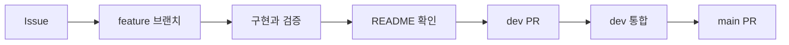

# Ipgo Client

개발 수동 배포는 같은 SHA의 성공한 dev push CI에서 전체 `ci:check`·빌드 증거를 확인해 재사용하고, Vercel Preview 환경에서 최종 빌드를 한 번 수행합니다. PR·push의 빌드 검사는 유지하며 세부사항은 [자동화 운영](docs/automation.md)을 따릅니다.

CI는 `ci:check`의 타입 검사가 통과한 뒤 `build:ci`로 번들을 생성합니다. 로컬·Vercel의 기본
`npm run build`는 타입 검사를 유지합니다. 설치는 기존 `npm ci`와 감사 검사를 유지하면서
다운로드 캐시를 우선 사용하고, Vercel CLI 패키지는 별도 캐시로 재사용합니다.

개발·운영 배포의 앱 의존성 설치는 Vercel 빌드 안의 `npm ci` 한 번으로 수행합니다.
운영의 전체 `ci:check`는 그 설치 후 앱 빌드 전에 실행하며 실패하면 게시하지 않습니다.
설치·검증 순서와 로컬 확인 범위는 [자동화 운영](docs/automation.md)을 따릅니다.

자동화 설정·검증 도구만 바뀐 로컬 작업은 `npm run verify:automation`으로 검사합니다.
앱/의존성/빌드 설정 변경은 이 경로가 거부하며, PR의 전체 검사는 유지합니다. [검사 선택](docs/automation.md#로컬-검사-선택)을 따릅니다.

Ipgo 서비스의 사용자 화면과 클라이언트 동작을 관리하는 React 애플리케이션입니다.
풀필먼트 수불부를 바탕으로 다음 입고 수량과 판단 근거를 제공하는 화면을 만듭니다.

Server25 범위의 확정 계약·API 명세 반영 결과와 검증 한계는 [엔진 계약 대조](docs/design/engine-contract-2026-11-05.md)를 참고합니다.

### 과거 업로드 마감 안내

업로드 결과가 `FAILED`이고 사유 코드가 `LEGACY_UPLOAD_CLOSED`이면 원본과 이력을
보존한 마감 기록으로 안내합니다. 재업로드나 재처리를 권하지 않고 대시보드로 이동합니다.
이 화면 분기는 업로드 상태나 원본을 변경하지 않으며, 실제 기록 마감은 별도 승인된 서버
데이터 작업입니다. 일반적인 파일 형식 오류와 서버 처리 실패의 기존 안내는 유지합니다.

### 판매 급변 안내

서버가 상품에 `demandShift`(판매 급증 `UP`·평소로 돌아옴 `DOWN`)를 주면 대시보드 목록에
꼬리표를 달고, "판매 급변" 칸으로 그 상품만 모아 봅니다. 계산(runId)마다 한 번 모아 알리고,
상품 상세에서는 지난 13주 하루 평균 판매 그래프와 함께 한 번 띄웁니다. 시나리오 카드에는 최근
속도로 다시 계산한 수량을 보여 주고 "이유 보기"로 그 안내를 다시 엽니다. 필드가 없으면 화면은
그대로입니다.

## 실행 환경

| 항목            | 기준                         |
| --------------- | ---------------------------- |
| Node.js         | 24 LTS                       |
| 패키지 관리자   | npm 11                       |
| 화면            | React + TypeScript           |
| 개발 서버·build | Vite                         |
| Router          | React Router Data Mode       |
| 서버 데이터     | TanStack Query               |
| Form·검증       | react-hook-form + Zod        |
| 스타일          | CSS Modules + CSS 변수 token |
| Mock API        | MSW                          |

## 시작하기

```bash
nvm use
npm ci
npm run dev
```

개발 서버는 기본적으로 `http://localhost:5173`에서 실행됩니다. 로컬 `.env`가 없으면 환경
변수 설명에 있는 이름으로 파일을 만들고 공개 가능한 값만 설정합니다.

### 시험 계정

| 항목     | 값             |
| -------- | -------------- |
| 이메일   | `seller@a.com` |
| 비밀번호 | `pass1234`     |

회원가입 비밀번호는 8~16자, 영문 대문자·소문자·숫자·특수문자를 모두 넣어야 합니다(예: `Abcd123!`, 규칙은 `src/auth/model/passwordRule.ts`). 시험 계정의 `pass1234`는 규칙 이전 계정이라 로그인만 됩니다.

회원가입을 시험할 때 이메일 인증 코드는 항상 `482915`입니다. 가입한 계정은 MSW 메모리에만 있어
브라우저를 새로고침하면 시험 계정만 남습니다.

요금제 예외 화면은 MSW로 볼 때 주소 끝에 `?demo=trial-ended`·`pay-failed`·`pay-locked`·`seller`·`trial`을 붙이면 그 구독 상태로 바뀝니다(`src/features/billing/mocks/billingHandlers.ts`의 `demoSubscription`). 상품 상세는 `/sku/reference-product`·`no-trend`·`new-product`·`missing-product`로 상태를 고릅니다.

인증은 서버 계약(ipgo-server #28)을 따릅니다. `shared/api/client.ts`가 아래를 자동으로 처리합니다.

- 로그인은 form 방식으로 보내고, 성공(200)하면 받은 액세스 JWT(15분)를 메모리에만 보관한 뒤
  `/auth/me`로 사용자 정보를 받습니다. 리프레시 토큰은 서버가 HttpOnly 쿠키로 관리합니다.
- 모든 요청에 `Authorization: Bearer <token>`과 쿠키(`credentials: 'include'`)를 붙입니다. 변경
  요청(POST 등)에는 `GET /auth/csrf`로 받은 CSRF 토큰도 넣습니다.
- `401 ACCESS_TOKEN_EXPIRED`를 받으면 `POST /auth/refresh`로 한 번 갱신하고 원래 요청을 한 번만
  다시 보냅니다. 여러 요청이 동시에 만료돼도 갱신은 한 번만 보냅니다. 다른 401은 갱신하지 않습니다.
- 새로고침으로 액세스 토큰을 잃으면 앱을 시작할 때 갱신으로 되살립니다. 갱신도 실패하면(7일 만료 등)
  로그인 화면으로 보내고 "로그인 시간이 끝났어요" 안내를 보여 줍니다.

MSW의 인증 mock(`src/auth/mocks/handlers.ts`)도 같은 규칙을 따릅니다.

로그인 화면의 "아이디 저장"은 이메일만 브라우저 `localStorage`(`ipgo:saved-email`)에 남기며 서버
로그인 유지와는 관계없습니다. 회원가입은 단계별 화면이라 `/signup`에서 새로고침하면 `/login`으로
돌아갑니다(`src/main.tsx`).

입고 조건의 "보관 비용"(창고 보관 요율, 상품별 상자 크기 cm)은 서버에 저장합니다(`GET·PUT
/api/settings/storage-cost`, `PUT·DELETE /api/products/{productId}/box`). 칸을 벗어나면 바로 저장하며, 한 달
보관비는 `상자 CBM × 권장 입고량 × 요율`로 화면에서 계산합니다(`src/features/settings/model/storageCost.ts`).

막 가입해 수불부가 없는 첫 대시보드에서는 요금제 카드 3장 창을 띄우고, 고르기 전엔 바깥 누르기·Esc·
뒤 화면이 막힙니다(`src/features/billing/components/PlanGate.tsx`). 체험을 고르면 시작 확인 창을 보이고
이 브라우저에 기억합니다(`ipgo:plan-picked:<이메일>`). 서버가 고른 시각을 주면(server #198) 그 값으로 바꿉니다.

요금제(`/plans`)·결제(`/checkout?plan=seller|business`)·내 계정(`/account`)은 서버 결제 API로
요금제·구독·결제 수단·청구 내역을 읽습니다. 토스 카드 등록 후 서버의 세션 조회에서 승인 성공을
확인해야 결제 완료로 안내합니다. 등록 완료 응답이 유실돼도 같은 세션을 조회하며, 결과가
미확정이면 실패로 단정하거나 새 결제를 요청하지 않습니다.

카드 등록은 누를 때마다 새 `Idempotency-Key`로 시작합니다. 같은 목적·요금제의 열린 세션은 서버가
새 키여도 이어받고, 같은 키는 끝난 시도의 결과를 그대로 돌려주므로 키를 저장하지 않습니다. 카드창을
닫거나 실패하고 돌아오면 그 세션을 한 번 취소합니다(`/registration-sessions/{id}/cancel`). 다른
시도가 아직 열려 있으면(409 `BILLING_IN_PROGRESS`) 1~2분 뒤 다시 하라고 안내합니다.

첫 결제가 거절되면 체험 중이거나 체험이 끝났어도 내 계정에서 기존 OPEN/DECLINED 청구를
다시 결제할 수 있습니다. 카드 교체만으로 기존 청구를 다시 결제하지 않으며, 교체 후 내 계정에서
재결제를 요청합니다. UNKNOWN/REVIEW_REQUIRED 청구에는 재결제 버튼을 제공하지 않습니다.
MSW는 이 흐름을 모의 처리합니다. 실제 토스 테스트 결제에는 서버 #170의 개발 환경·키 준비가,
환불에는 서버 #171의 API가 필요합니다.

## 명령

| 명령                        | 설명                                                                |
| --------------------------- | ------------------------------------------------------------------- |
| `npm run dev`               | 개발 서버 실행                                                      |
| `npm run build`             | TypeScript 검사 후 production build                                 |
| `npm run typecheck`         | TypeScript 검사                                                     |
| `npm run lint`              | ESLint 검사                                                         |
| `npm run format:check`      | Prettier 형식 검사                                                  |
| `npm test`                  | Vitest 테스트 1회 실행                                              |
| `npm run test:watch`        | Vitest watch 실행                                                   |
| `npm run ci:check`          | CI에서 사용하는 전체 코드 검사                                      |
| `npm run automation:test`   | 자동화 단위 검사와 API 통신을 차단한 모의 통합 검사                 |
| `npm run verification:test` | 로컬 검증 도구의 중단·요청 차단 규칙 검사                           |
| `npm run verify:browser`    | 로컬 합성 응답으로 PC·모바일 화면 검사·캡처                         |
| `npm run verify:local`      | 포맷 확인 → 검증 도구 검사 → 기존 전체 검사 → 빌드 → PC·모바일 검증 |

`ci:check`는 기존 앱·자동화 검사에 검증 도구 단위 검사도 추가로 실행합니다.
브라우저 검사는 화면 연결 IPGO-196 선행 병합 후 사용합니다.

화면 수정의 반복 탐색·모의 응답 준비·결과 기록은 [구현·검증 절차](docs/rules/workflow.md#구현검증-절차)를
따릅니다. 최초 한 번 `npm ci` 후 `npx playwright install chromium`으로 브라우저를 준비합니다.
검증 명령은 브라우저를 자동 다운로드하거나 실제 API에 업로드하지 않습니다. 실행 중인 프로젝트
config에 실제 API proxy가 있으면 브라우저 검증을 중단합니다.

`verify:local`은 `.env`를 작성하거나 소스를 자동 포맷하지 않습니다. 명시적으로 수정한 파일만
포맷한 뒤 실행합니다. 원문 로그·PC/모바일 캡처·진행 상태와 최종 결과(`summary.json`)는
저장소 밖의 새 보호 폴더에 모읍니다. 기본 위치는 OS 임시 폴더이며, 장기 보관이 필요하면
이미 존재하는 저장소 밖 경로를 `IPGO_VERIFY_OUTPUT_ROOT`로 지정합니다. 폴더0700/파일0600이며
임시 서버·브라우저는 검사 종료 시 닫습니다. 실패하면 후속 단계는 실행하지 않습니다.

브라우저 검증은 현재 실패 이유·작년 출고 연결과 주변 인증/설정 API의 **합성 응답**을
재사용합니다. 화면/요청이 바뀌면 `scripts/verification/browser-fixtures.mjs`와 확인 동작을
함께 갱신합니다. 알 수 없는 API·예상 밖 쓰기·외부 주소는 실제로 전송하지 않고 실패로 남깁니다.
외부 font CSS도 빈 응답으로 대체합니다. PC1280/모바일390 viewport의 Chromium 검증이며
실제 모바일 기기·실계정·실데이터 업무 E2E 또는 개발 사이트 배포의 성공을 뜻하지 않습니다.

## 환경 변수

| 이름                   | 필수   | 설명                                                                                                                                                                    |
| ---------------------- | ------ | ----------------------------------------------------------------------------------------------------------------------------------------------------------------------- |
| `VITE_API_BASE_URL`    | 아니요 | API 요청의 기본 경로이며 기본값은 `/api`입니다.                                                                                                                         |
| `VITE_ENABLE_MSW`      | 아니요 | `true`이면 브라우저에서 MSW를 시작합니다.                                                                                                                               |
| `VITE_TOSS_CLIENT_KEY` | 아니요 | 토스페이먼츠 카드 등록창 클라이언트 키(`test_ck_...`). 없고 MSW가 켜져 있으면 결제사 없이 가짜로 돌아오고, 둘 다 없으면 결제를 시작할 수 없습니다.                      |
| `API_PROXY_TARGET`     | 아니요 | 개발 서버가 `/api` 요청을 넘겨 줄 서버 주소(예: `http://localhost:8080`). 브라우저에는 노출되지 않습니다. 실제 서버로 확인할 때는 `VITE_ENABLE_MSW`를 `false`로 둡니다. |

배포 화면(Vercel)에서는 `vercel.json`이 `/api/*` 요청을 개발 서버
`https://ipgo-dev-api.iwhya.kr/api/*`로 넘깁니다. 배포 화면을 실제 서버로 보려면 Vercel 환경 변수
`VITE_ENABLE_MSW`를 `false`로 두고 다시 배포합니다. 운영 서버 주소가 따로 생기면 `main`에 반영하기 전에
이 주소를 바꿉니다.

`.env`와 `.env.*`는 Git에서 제외됩니다. `VITE_*` 값은 build 결과에 포함되어 브라우저에서
확인할 수 있으므로 token, 비밀번호, private API key를 넣으면 안 됩니다. 실제 비밀값은
백엔드 또는 배포 환경의 서버 전용 비밀 저장소에서 관리합니다.

## 구조

```text
src/
├─ app/            provider, router, 공통 layout
├─ auth/           인증 상태와 인증 화면
├─ features/       dashboard, upload, settings, sku
├─ shared/         공통 API, 환경 설정, UI
├─ styles/         token과 전역 기본 스타일
├─ mocks/          브라우저·테스트 공용 MSW handler
└─ test/           테스트 공통 설정
```

### 의존성 방향

1. `app`은 route와 provider를 조립합니다.
2. `auth`와 각 `features`는 `shared`를 사용할 수 있습니다.
3. feature끼리는 직접 참조하지 않습니다.
4. 두 기능 이상에서 실제로 재사용하는 코드만 `shared`로 이동합니다.
5. 서버 데이터는 TanStack Query, Form 값은 react-hook-form, 인증 상태는 `auth`가 소유합니다.

## Route

| 주소                       | 접근        | 담당                 |
| -------------------------- | ----------- | -------------------- |
| `/login`                   | 비로그인    | `auth`               |
| `/signup`                  | 비로그인    | `auth`               |
| `/dashboard`               | 로그인 필요 | `features/dashboard` |
| `/upload`                  | 로그인 필요 | `features/upload`    |
| `/upload/:uploadId/result` | 로그인 필요 | `features/upload`    |
| `/settings`                | 로그인 필요 | `features/settings`  |
| `/sku/:skuId`              | 로그인 필요 | `features/sku`       |

## CSS 규칙

- 전역 CSS는 `src/styles/tokens.css`와 `src/styles/base.css`만 사용합니다.
- 컴포넌트 스타일은 같은 위치의 `*.module.css`에 작성합니다.
- 색, 크기, 간격은 가능한 한 `tokens.css`의 CSS 변수를 사용합니다.
- 성공·주의·오류 색은 [Design B 의미 색 기준](docs/design/semantic-colors.md)을 따릅니다.
- 고정 모양은 inline style로 작성하지 않습니다.
- 공통 UI의 내부 색과 높이를 기능 화면에서 덮어쓰지 않습니다.

## Mock API

MSW handler는 기능별 mock을 모아 `src/mocks/handlers.ts`에서 조립합니다. 같은 handler를
개발 브라우저와 Vitest에서 함께 사용하며, 실제 API 코드에는 mock 분기를 넣지 않습니다. 인증 API(A1~A7) mock은
`src/auth/mocks/handlers.ts`에 있습니다.

서버에 아직 없는 주소는 팀 API 명세(`docs/design/api-spec.docx`)와 ipgo-server ERD v1대로 요청 코드와
mock을 먼저 만들어 둡니다. 서버가 열리면 `API_PROXY_TARGET`만 바꾸면 됩니다.

| 명세           | 주소                                                    | 요청 코드                             |
| -------------- | ------------------------------------------------------- | ------------------------------------- |
| C2 계산 상태   | `GET /calculation-runs/{runId}`                         | `src/shared/api/calculationRunApi.ts` |
| K2·K3 시나리오 | `GET·POST /results/{resultId}/scenarios`                | `src/features/sku/model/resultApi.ts` |
| K4 AI 인사이트 | `GET /results/{resultId}/insight` (응답은 ipgo-ai 0002) | `src/features/sku/model/resultApi.ts` |

K4가 `202 {"status":"GENERATING"}`을 반환하면 설명 생성 중 표시를 유지하고 2초마다
재조회합니다. AI/FIXED/TABLE_ONLY로 완료되면 재조회를 멈춥니다. 생성 중에는 비활성/빈 설명으로
표시하지 않으며 시나리오 표는 계속 볼 수 있습니다. 조회 오류에는 기존 다시 불러오기 안내를 사용합니다.
설명 GET 재조회는 유료 생성 요청을 시작하지 않습니다.

모의 API 모드에서는 각 API 요청 전에 서비스 워커에 현재 탭을 다시 등록하고 준비 응답을
기다립니다. 포커스된 탭에서 워커가 중단돼도 다음 요청으로 복구하며, 동시에 시작된 요청은
같은 준비 검사를 공유합니다. 3초 안에 확인하지 못하면 HTTP 요청을 보내지 않고 기존 연결
오류 안내를 표시합니다. 복구를 이유로 로그인·저장 POST를 자동 재전송하지 않습니다.
실제 API 모드에는 이 준비 검사와 MSW 브라우저 모듈을 설치하지 않습니다.

이 복구는 현재 lockfile의 MSW 3.0.3 메시지 프로토콜에 의존합니다. MSW를 올릴 때는 생성된
`public/mockServiceWorker.js`를 직접 고치지 말고, 포커스 이동 없이 워커를 중단하는 브라우저
검증과 준비 실패·중복 전송 방지 테스트를 다시 확인합니다.

## 대시보드 목록과 발주 CSV

대시보드 숫자 상자를 누르면 해당 상품 목록을 보고 상품명·바코드로 검색할 수 있습니다.
서버가 아직 괜찮은 상품 목록을 제공하지 않으면 상품 API의 모든 페이지를 조회해 분류합니다.
중간 페이지를 포함해 조회에 실패하면 빈 목록 대신 오류와 다시 시도 버튼을 표시합니다.

입고 필요 상품을 체크하면 수량·사입비 합계를 보고 발주 목록을 CSV로 받을 수 있습니다.
CSV는 한글 표시를 위한 BOM을 포함하며, 상품명·바코드 등 문자열이 수식으로 해석되지 않도록
수식 시작 문자 앞에 작은따옴표를 붙입니다. 숫자 수량·금액은 숫자로 유지합니다.

## 계산 완료·실패 추적

새 수불부 업로드를 시작하면 이전 계산의 완료·실패 안내를 닫습니다. 새 정제 실패를
계산 완료로 안내하지 않으며, 이전 정상 계산 결과는 그대로 유지합니다.

업로드 정제 완료, 입고 조건 저장, 발주 등록·수정·취소에서 받은 실제 `runId`를
공통 계산 상태로 전달합니다. `QUEUED`/`RUNNING`은 2초 간격으로 조회하고 새 계산 요청을
잠급니다. `DONE`이면 대시보드·상품 상세·시나리오·설명 캐시를 갱신한 뒤 완료를 알립니다.
`FAILED`이면 사유를 알리고 이전 정상 결과를 유지합니다.

“계산 멈추기”·“그만 기다리기”는 로컬 추적과 새로고침용 추적 번호를 즉시 지우고
서버 취소를 별도로 요청합니다. 취소 응답이 늦거나 실패해도 새 계산 추적을 지우지 않습니다.
서버 취소 API가 없거나 요청이 실패하면 서버 계산은 계속될 수 있으므로 이 동작을 서버 중지
성공으로 표시하지 않습니다.

조회 오류나 5분간 확인되지 않은 상태는 계산 실패로 단정하지 않습니다. “상태 다시 확인”은
같은 계산의 GET만 보내며 업로드나 조건 저장을 다시 실행하지 않습니다. 화면 이동 중에도
추적을 유지하고, 같은 탭 새로고침 시 로그인 사용자와 묶인 `sessionStorage`의 계산 번호를
복구합니다. 토큰·비밀번호는 이 저장소에 넣지 않으며 로그아웃 시 계산 번호를 지웁니다.
브라우저가 탭 저장소를 막으면 현재 화면에서만 추적됩니다.

발주 수정·취소는 기존 본문/204를 유지하는 서버의 `X-Calculation-Run-Id` 헤더를 사용합니다.
이 헤더를 추가하는 서버 변경을 먼저 배포해야 해당 두 흐름도 추적할 수 있습니다. 구버전
서버에서 헤더가 없으면 가짜 계산 번호를 만들지 않습니다.

실서버 검증 순서와 승인 경계는 [MVP 통합 검증 준비](docs/mvp-flow-validation.md)를 봅니다.

## 작업 흐름

계산 상태 창은 새 계산이나 단계 변경 후 5초 뒤 작은 알약으로 접힙니다. 마우스나
키보드 포커스가 창 안에 있으면 펼친 상태를 유지하며, 완료·실패 알림은 확인을 눌러
닫습니다. 이전 계산의 접힘 상태는 다음 계산에 이어지지 않습니다.



- Issue의 목적과 완료 조건을 먼저 확인합니다.
- 최신 `dev`에서 `feature/<issue-number>-<description>` 브랜치를 만듭니다.
- commit은 `type: short English summary` 형식을 사용합니다.
- 구현과 검증 후 `dev` 대상 PR을 생성합니다.
- `main` 변경은 `dev → main` PR로만 진행합니다.

## 자동화

- Jira 작업은 GitHub Issue와 연결하고 상태·댓글·담당자·기간을 동기화합니다.
- 신규 작업은 저장소별로 분류하며, 클라이언트 자동화는 클라이언트 대상만 생성합니다.
- 회의·전체 일정은 Jira 전용으로 두고, 과거 미러·참조 정본은 상태·댓글·담당자 쓰기와 재생성에서 제외합니다.
- PR·운영 완료도 정본과 저장소를 확인하며, 본문의 참고 키나 후속 PR로 다른 작업·완료 상태를 바꾸지 않습니다.
  생성 한도를 넘으면 신규 생성만 보류하고 기존 연결 작업은 계속 갱신합니다.
- Issue 제목에 Jira 키를 명시합니다. 본문에 적힌 참고 키만으로 작업을 연결하지 않습니다.
- GitHub Issue의 기간은 조직 Project `IpgoITGO 작업 일정`의 `시작일`·`마감일` 필드에 표시합니다.
- 승인된 PR을 사람이 병합하면 `dev`는 개발 주소, `main`은 운영 주소로 Vercel 배포를 시작합니다.
- `dev → main` PR 제목에는 운영 배포 후 완료할 Jira 키를 모두 포함합니다.
- PR 자동 승인·자동 병합과 Jira 스프린트 자동 배정은 하지 않습니다.

필요한 GitHub Variables·Secrets와 복구 절차는 [자동화 운영 문서](docs/automation.md)를 따릅니다.

## 문서

- [개발 문서 안내](docs/README.md)
- [작업 흐름](docs/rules/workflow.md)
- [작성 규칙](docs/rules/conventions.md)
- [안전 규칙](docs/rules/safety.md)
- [자동화 운영](docs/automation.md)

### 수불부 검증과 결과 안내

- 입력 문제(`INVALID_SOURCE`)는 서버의 `error.reason`을 결과 화면과 상단 처리 안내에
  우선 표시합니다. 이유가 없으면 기존 `error.message`를 유지하고, 전월 자료 연결 코드
  (`PREVIOUS_MONTH_MISMATCH`)만 있는 경우 같은 셀러·창고의 자료인지 확인하도록 안내합니다.
  서버 장애의 내부 이유와 과거 업로드 마감의 기존 분기는 구분합니다.
- 상품 상세의 **재고·출고** 그래프는 `trend[].lastYearOutboundQty`를 같은 날짜의
  점선과 점으로 표시합니다. 범례와 날짜별 안내에 작년 출고를 구분하며, `0`은 실제
  0개로, `null`/필드 누락은 기록 없음으로 처리하고 빈 날짜에서 선을 끊습니다.
  작년 값도 세로 눈금 범위에 포함합니다. 주별 집계·미래 예측과 계산식은 변경하지 않습니다.
- `2026-09.xlsx`와 숫자 복사본 이름(`2026-09 1.xlsx`, `2026-09 (1).xlsx`)을 지원합니다.
  선택한 파일의 내용은 유지하고 서버에는 해당 월의 표준 이름으로 전송합니다. 월이 모호한
  이름은 추측하지 않고 이름 변경을 안내합니다.
- 업로드 결과는 이번 파일의 정제·검산 결과입니다. 실제 계산 완료 여부와 이전 달을 포함한
  제외·기록 부족 결과는 대시보드에서 확인합니다.
- 상품 상세는 서버의 현재 판정이 재업로드 필요이면 오래된 권장값을 정상 결과로 보여 주지
  않습니다. AI 설명 비활성과 생성 실패, 기본 계산 방식과 실제 평가 근거를 구분합니다.
- 실측 비교 이력이 없는 정확도는 미평가로 표시합니다. 신상품은 필요한 기록 일수를 먼저
  안내하고 원래 계산 사유는 펼쳐서 볼 수 있습니다. 모바일 표는 키보드와 가로 스크롤로
  권장량·사입비까지 확인할 수 있습니다.

### 입고 주기 제안과 확인 (#92)

입고 조건 화면은 S1·P1의 `reviewCycleDays: number | null`을 그대로 받습니다.
유효한 입고 기록이 부족하면 빈칸과 직접 입력 안내를 표시합니다. 상품별로 저장한 값이
없는 행은 기본값의 제안/수동 입력을 따르며, 기본값을 바꿔도 상품별 저장값은 유지합니다.
저장할 때는 직접 수정한 상품 칸과 기존 상품별 설정만 S3로 보내고 마지막에 S2를 저장합니다.
재조회는 편집 중인 칸을 보존하며 사용자가 확인하기 전에 제안값으로 계산하지 않습니다.

## 상품 상세 정확도 이력 (#93)

현재 계산과 같은 산식·배수·설정으로 2026년 5~7월 TUNE 자료를 재생한 이력을 연결합니다.
각 점은 기준일 다음 날부터 리드타임+검토 주기(H일)의 예측/관측 출고 합계입니다.
당시 발행한 예측의 실측 성과나 독립 TEST 성과가 아닙니다. 겹친 평가 창은 독립 표본으로 해석하지 않습니다.
`covered`는 입고 재생에서 매일 기말 재고가 양수였는지를 뜻합니다.

AI의 CALCULATE `accuracyEvaluation`은 선택적 확장 필드입니다. 원본 소수와 정책·입력 digest를
서버의 기존 `selection_snapshot.resultFacts`에 저장하며, K1에는 정수 올림한 `accuracy.history`와
출처/기간/H/평가 상태를 담은 선택적 `accuracy.evaluation`을 제공합니다. 오차는 원본으로 계산합니다.
기록 없는 구버전은 빈 이력, 표본 없음은 EMPTY, 평가 미실행은 UNAVAILABLE로 구분합니다.
새 BACKTEST 작업·DB migration·LLM 호출·과거 결과 덮어쓰기는 없습니다.

## 개발 배포 전 검증

PR/dev push는 코드 검사·테스트·build만 수행합니다. 실제 개발 배포는 정확한 전체 commit SHA를
승인받은 뒤 `Vercel 개발 배포`를 dev에서 수동 실행하고 `expected_sha`로 전달합니다.
Git 연동 자동 배포도 꺼져 있으며 자세한 승인·복구 절차는 [자동화 운영](docs/automation.md)을 따릅니다.

## 내 입고량 저장

상품 상세에서 정한 입고량은 로그인한 계정의 서버 자료로 저장하고 대시보드·주문 Excel에
같이 반영합니다. 저장·삭제가 실패하면 기존 값을 유지하고 안내합니다. 조회가 실패하면
주문 수량을 확정하지 않도록 Excel 받기를 막습니다. 권장 100%를 선택한 수량도 다음 계산에서
자동으로 새 권장량으로 바꾸지 않습니다.

계산 기준은 날짜 대신 서버의 calculationRunId로 비교합니다. 상세 K1에 runId가 없어 D1을
전후로 조회해 같은 계산의 상세 결과임을 확인한 뒤 저장합니다. 조회 중 계산이 바뀌면
저장하지 않고 새로고침을 안내합니다. 기준일이 같은 재계산도 이전 계산으로 구분합니다.
계정 소유가 없는 예전 localStorage 자료는 읽거나 자동 이전하지 않습니다.

## 입고 확인과 정정

메뉴의 **입고 확인**에서 현재 확인이 필요한 항목과 완료 이력을 봅니다. 이전 원본·최신 원본·
현재 연결된 발주를 비교한 뒤, 서버가 허용한 동작만 선택할 수 있습니다. 저장은 이유 입력 →
서버 미리보기 → 변경 영향 확인 순서이며, 단순 조회나 자동 선택으로 확정하지 않습니다.

응답을 잃으면 같은 내용의 저장 결과만 재확인합니다. 미확인 요청은 같은 계정·같은 항목에
한해 이 탭에서 복구하며, 성공·로그아웃 시 임시 보관 내용을 지웁니다. 최신 자료가 달라졌거나
정제가 실패하면 새 확인이 필요합니다. 과거 업로드의 경고는 당시 기록으로 유지합니다.
정정 저장과 후속 계산의 성공·실패는 따로 표시합니다.

실제 정정은 발주 배정·예정 입고·재계산에 영향을 줄 수 있습니다. 개발 배포나 실제 쓰기
검증은 별도 승인 전에는 실행하지 않습니다. [입고 확인 계약과 검증](docs/receipt-corrections.md)을 참고하세요.

## 개발 환경 토스 TEST 결제·전액 취소

서버 #170/171 활성화·키 준비와 승인된 배포가 선행돼야 합니다. 토스 API 개별 연동용 `test_ck_...`만 `VITE_TOSS_CLIENT_KEY`로 브라우저에 제공합니다. `test_sk_...`·보안키·서버 저장 키는 브라우저/코드/로그에 넣지 않습니다. MSW 화면 통과와 실제 토스 성공은 별개입니다. 실제 TEST 셀러 카탈로그는 월500원이며 서버 요금제 응답을 따릅니다.

내 계정 → 최신 결제 내역 → 결제 취소·환불 → 전액 취소 요청으로 시험합니다. 구독 해지는 다음 청구 중단이고 이 기능은 승인된 결제의 전액 취소입니다. 서버가 CANCELED를 확인해야 완료로 안내하며, PROCESSING/UNKNOWN은5초마다 내역을 조회하고 REVIEW_REQUIRED는 확인 필요로 남깁니다. 확정 취소는 유료 이용을 종료하고 다음 자동 청구도 중지합니다. 실제 돈은 청구·환불되지 않으며 부분 취소·과거 청구·LIVE는 지원하지 않습니다.

## TEST 일반결제 1개월 이용권

서버 요금제 interval이 ONE_TIME이면 /checkout에서 토스 주문서형 일반결제를 사용합니다.
VITE_TOSS_CLIENT_KEY에는 같은 상점·환경의 test_gck_ 클라이언트 키를 지정합니다.
시크릿 키(test_gsk_)는 서버에만 둡니다. 기존 test_ck_ 키는 자동결제용 레거시 흐름이며 단순 교체하지 않습니다.
서버 주문 생성 → 결제 수단/약관 표시 → 토스 인증 → /payment/success 복귀 → 서버 승인 순서입니다.
가상계좌 입금 대기는 완료로 표시하지 않습니다. /account의 결제 상태 다시 확인 또는 서버 작업기로 확인하며,
서버가 DONE을 확인한 뒤 한 달 이용권을 부여합니다. 자동 갱신·정기 청구는 없고 만료 후 직접 다시 결제합니다.
일반결제에서는 정기결제용 해지·해지 취소 버튼을 표시하지 않습니다. 자동결제 기능이 차단된 응답은 자동 갱신이 없다는 설명과 결제 내역의 취소·환불 경로로 안내합니다.
유효 이용권 중 중복 구매/요금제 변경은 지원하지 않습니다. 최신 결제의 전액 취소는 기존 계정 화면에서 제공합니다.
서버 V27·일반결제 모드와 함께 배포해야 하며 배포/Secret 변경은 별도 승인입니다.
SDK stub·합성 API 화면 테스트는 실제 PG 승인/입금/환불 성공과 구분합니다.

## 발주 필요 브라우저 알림 (#324 / IPGO-229)

내 계정의 **발주 필요 알림**에서 받을 정시를 고르고 “알림 켜고 이 브라우저 연결”을 누릅니다.
브라우저 권한을 허용해야 수신 설정을 켭니다. 기본은 꺼짐/9시/Asia/Seoul이며 저장된 시간대를 표시합니다.
다중 기기에서는 각 브라우저를 연결해야 하고, “알림 끄기”는 모든 기기의 하루 1회 수신 설정을 끄고 현재 브라우저를 해제합니다.
로그아웃 전에 본인 endpoint의 서버 연결과 브라우저 구독을 해제합니다. 서버 해제가 실패해도 native unsubscribe가 성공하면 로그아웃을 계속합니다.
둘 다 실패하면 로그아웃을 막고 기존 로컬 로그아웃 선택 경로에서도 브라우저 해제를 시도합니다.
로그인/구독 변경 뒤 이미 권한을 허용한 브라우저는 켜진 수신 설정에 한해 재등록합니다. 자동으로 권한 팝업을 띄우거나 수신 설정을 켜지 않습니다.

서버 계약은 `/notifications/settings` GET/PATCH, `/push/public-key` GET, `/push/subscriptions` POST/DELETE입니다.
공개키가 없으면 연결을 막고 준비 중으로 안내합니다. 실제 사이트의 HTTPS PC Chrome/Edge/Firefox/Safari가 첫 대상이며 iPhone Safari는 제외합니다.
`VITE_ENABLE_MSW=true`에서는 연결을 막아 root scope의 `/mockServiceWorker.js`와 충돌하지 않습니다.
실제 worker는 `/push-sw.js`이며 `daily-기기발송ID` payload만 표시하고 클릭은 같은 사이트 `/dashboard`로만 이동합니다.
endpoint·키·인증 token을 localStorage에 저장하거나 로그에 출력하지 않습니다.

서버의 자동 worker 활성화와 V28 적용 전에는 구독/설정만 가능하며 자동 알림은 오지 않습니다.
발주 필요 상품이 없거나 계산이 오래됐거나 갱신 중이면 발송하지 않고, 공급자 수락과 실제 OS 표시를 구분합니다.
시험 Preview에서 허용했던 권한은 이 사이트에 적용되지 않으므로 기존 개발 사이트에서도 한 번 연결해야 합니다.
합성 검사는 `npm exec vitest -- run src/features/notifications`와 `node --test scripts/verification/push-sw.node-test.mjs`로 실행합니다.
개발 배포 후 사이트를 닫은 상태의 실제 수신·클릭 이동은 동의한 시험 기기에서 별도로 확인합니다.

## TEST 가상계좌 발급 취소·환불

Server V30와 대응 API가 적용된 뒤 배포합니다. 결제 내역의 `paymentMethod`로 가상계좌를 구분하며 기존 응답에 결제수단이 없더라도 서버의 ACCOUNT_REQUIRED 결과를 받으면 계좌 입력을 안내합니다.

- 입금 전에는 결제 내역의 **가상계좌 발급 취소**에서 계좌 정보 없이 취소합니다. 입금 전 취소가 기존 체험/다른 이용권을 종료하지는 않습니다.
- 입금 후에는 **결제 취소·환불**에서 환불 은행·계좌번호·예금주를 입력합니다. 계좌번호의 공백/하이픈은 제거하고 필수값과 길이를 검사합니다.
- ACCOUNT_REQUIRED는 같은 창에서 계좌를 다시 입력할 수 있습니다. 결과가 불명확한 UNKNOWN이나 PROCESSING은 다시 취소하지 않고 조회합니다. REVIEW_REQUIRED는 확인 필요로 표시합니다.
- 주문 취소와 은행 환불 완료를 구분합니다. 가상계좌 PROCESSING은 **환불 처리 중**이며, 서버가 완료를 확인한 뒤에만 **취소·환불 완료**로 안내합니다.

계좌정보는 폼이 열린 동안 메모리에서만 다루며 닫기/요청 접수 뒤 지웁니다. URL·localStorage·쿼리캐시에 저장하지 않습니다. 서버는 처리 중 복구를 위해 암호화된 계좌만 일시 보관하며 응답에 계좌를 돌려주지 않습니다. 일반결제·정기결제·기존 계좌이체 취소 흐름은 유지합니다.

자동화 검사는 합성 API·가짜 PG 기반이며 실제 가상계좌 발급/입금/은행 환불 성공을 뜻하지 않습니다. 실제 금융 흐름 검증과 migration/배포는 별도 단계입니다. [Toss 취소 계약](https://docs.tosspayments.com/guides/v2/cancel-payment).
