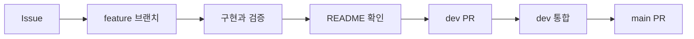

# Ipgo Client

Ipgo 서비스의 사용자 화면과 클라이언트 동작을 관리하는 React 애플리케이션입니다.
풀필먼트 수불부를 바탕으로 다음 입고 수량과 판단 근거를 제공하는 화면을 만듭니다.

Server25 범위의 확정 계약·API 명세 반영 결과와 검증 한계는 [엔진 계약 대조](docs/design/engine-contract-2026-11-05.md)를 참고합니다.

### 과거 업로드 마감 안내

업로드 결과가 `FAILED`이고 사유 코드가 `LEGACY_UPLOAD_CLOSED`이면 원본과 이력을
보존한 마감 기록으로 안내합니다. 재업로드나 재처리를 권하지 않고 대시보드로 이동합니다.
이 화면 분기는 업로드 상태나 원본을 변경하지 않으며, 실제 기록 마감은 별도 승인된 서버
데이터 작업입니다. 일반적인 파일 형식 오류와 서버 처리 실패의 기존 안내는 유지합니다.

## 실행 환경

| 항목            | 기준                         |
| --------------- | ---------------------------- |
| Node.js         | 24 LTS                       |
| 패키지 관리자   | npm 11                       |
| 화면            | React + TypeScript           |
| 개발 서버·build | Vite                         |
| Router          | React Router Data Mode       |
| 서버 데이터     | TanStack Query               |
| Form·검증       | react-hook-form + Zod        |
| 스타일          | CSS Modules + CSS 변수 token |
| Mock API        | MSW                          |

## 시작하기

```bash
nvm use
npm ci
npm run dev
```

개발 서버는 기본적으로 `http://localhost:5173`에서 실행됩니다. 로컬 `.env`가 없으면 환경
변수 설명에 있는 이름으로 파일을 만들고 공개 가능한 값만 설정합니다.

### 시험 계정

| 항목     | 값             |
| -------- | -------------- |
| 이메일   | `seller@a.com` |
| 비밀번호 | `pass1234`     |

회원가입 비밀번호는 8~16자, 영문 대문자·소문자·숫자·특수문자를 모두 넣어야 합니다(예: `Abcd123!`, 규칙은 `src/auth/model/passwordRule.ts`). 시험 계정의 `pass1234`는 규칙 이전 계정이라 로그인만 됩니다.

회원가입을 시험할 때 이메일 인증 코드는 항상 `482915`입니다. 가입한 계정은 MSW 메모리에만 있어
브라우저를 새로고침하면 시험 계정만 남습니다.

요금제 예외 화면은 MSW로 볼 때 주소 끝에 `?demo=trial-ended`·`pay-failed`·`pay-locked`·`seller`·`trial`을 붙이면 그 구독 상태로 바뀝니다(`src/features/billing/model/billing.ts`의 `demoSubscription`). 상품 상세는 `/sku/reference-product`·`no-trend`·`new-product`·`missing-product`로 상태를 고릅니다.

인증은 서버 계약(ipgo-server #28)을 따릅니다. `shared/api/client.ts`가 아래를 자동으로 처리합니다.

- 로그인은 form 방식으로 보내고, 성공(200)하면 받은 액세스 JWT(15분)를 메모리에만 보관한 뒤
  `/auth/me`로 사용자 정보를 받습니다. 리프레시 토큰은 서버가 HttpOnly 쿠키로 관리합니다.
- 모든 요청에 `Authorization: Bearer <token>`과 쿠키(`credentials: 'include'`)를 붙입니다. 변경
  요청(POST 등)에는 `GET /auth/csrf`로 받은 CSRF 토큰도 넣습니다.
- `401 ACCESS_TOKEN_EXPIRED`를 받으면 `POST /auth/refresh`로 한 번 갱신하고 원래 요청을 한 번만
  다시 보냅니다. 여러 요청이 동시에 만료돼도 갱신은 한 번만 보냅니다. 다른 401은 갱신하지 않습니다.
- 새로고침으로 액세스 토큰을 잃으면 앱을 시작할 때 갱신으로 되살립니다. 갱신도 실패하면(7일 만료 등)
  로그인 화면으로 보내고 "로그인 시간이 끝났어요" 안내를 보여 줍니다.

MSW의 인증 mock(`src/auth/mocks/handlers.ts`)도 같은 규칙을 따릅니다.

로그인 화면의 "아이디 저장"은 이메일만 브라우저 `localStorage`(`ipgo:saved-email`)에 남기며 서버
로그인 유지와는 관계없습니다. 회원가입은 단계별 화면이라 `/signup`에서 새로고침하면 `/login`으로
돌아갑니다(`src/main.tsx`).

입고 조건의 "보관 비용"(창고 보관 요율, 상품별 상자 크기 cm)은 서버 API가 생기기 전까지 브라우저
`localStorage`(`ipgo:storage-cost`)에만 저장합니다. 다른 기기·브라우저와 공유되지 않으며, 한 달
보관비는 `상자 CBM × 권장 입고량 × 요율`로 화면에서 계산합니다(`src/features/settings/model/storageCost.ts`).

요금제(`/plans`)와 결제(`/checkout?plan=seller|business`)는 요구사항 밖 추가 기능이며 서버 API가
아직 없습니다. 구독 상태는 브라우저 `localStorage`(`ipgo:subscription`)에만 두고 처음 열면 14일
체험이 시작됩니다. 결제창·승인 확인은 `src/features/billing/model/payment.ts`가 모의로 성공을
돌려주며, 포트원 키와 서버 승인 API가 생기면 이 함수만 바꿉니다. 실제로 돈이 나가지 않습니다.
위쪽 오른쪽 이름을 누르면 계정 메뉴(내 계정·요금제·결제·로그아웃)가 열리고, 내 계정(`/account`)은
같은 구독 상태로 요금제·사용량·결제 내역·해지 예정일을 보여 줍니다.

## 명령

| 명령                      | 설명                                                |
| ------------------------- | --------------------------------------------------- |
| `npm run dev`             | 개발 서버 실행                                      |
| `npm run build`           | TypeScript 검사 후 production build                 |
| `npm run typecheck`       | TypeScript 검사                                     |
| `npm run lint`            | ESLint 검사                                         |
| `npm run format:check`    | Prettier 형식 검사                                  |
| `npm test`                | Vitest 테스트 1회 실행                              |
| `npm run test:watch`      | Vitest watch 실행                                   |
| `npm run ci:check`        | CI에서 사용하는 전체 코드 검사                      |
| `npm run automation:test` | 자동화 단위 검사와 API 통신을 차단한 모의 통합 검사 |

## 환경 변수

| 이름                | 필수   | 설명                                                                                                                                                                    |
| ------------------- | ------ | ----------------------------------------------------------------------------------------------------------------------------------------------------------------------- |
| `VITE_API_BASE_URL` | 아니요 | API 요청의 기본 경로이며 기본값은 `/api`입니다.                                                                                                                         |
| `VITE_ENABLE_MSW`   | 아니요 | `true`이면 브라우저에서 MSW를 시작합니다.                                                                                                                               |
| `API_PROXY_TARGET`  | 아니요 | 개발 서버가 `/api` 요청을 넘겨 줄 서버 주소(예: `http://localhost:8080`). 브라우저에는 노출되지 않습니다. 실제 서버로 확인할 때는 `VITE_ENABLE_MSW`를 `false`로 둡니다. |

배포 화면(Vercel)에서는 `vercel.json`이 `/api/*` 요청을 개발 서버
`https://ipgo-dev-api.iwhya.kr/api/*`로 넘깁니다. 배포 화면을 실제 서버로 보려면 Vercel 환경 변수
`VITE_ENABLE_MSW`를 `false`로 두고 다시 배포합니다. 운영 서버 주소가 따로 생기면 `main`에 반영하기 전에
이 주소를 바꿉니다.

`.env`와 `.env.*`는 Git에서 제외됩니다. `VITE_*` 값은 build 결과에 포함되어 브라우저에서
확인할 수 있으므로 token, 비밀번호, private API key를 넣으면 안 됩니다. 실제 비밀값은
백엔드 또는 배포 환경의 서버 전용 비밀 저장소에서 관리합니다.

## 구조

```text
src/
├─ app/            provider, router, 공통 layout
├─ auth/           인증 상태와 인증 화면
├─ features/       dashboard, upload, settings, sku
├─ shared/         공통 API, 환경 설정, UI
├─ styles/         token과 전역 기본 스타일
├─ mocks/          브라우저·테스트 공용 MSW handler
└─ test/           테스트 공통 설정
```

### 의존성 방향

1. `app`은 route와 provider를 조립합니다.
2. `auth`와 각 `features`는 `shared`를 사용할 수 있습니다.
3. feature끼리는 직접 참조하지 않습니다.
4. 두 기능 이상에서 실제로 재사용하는 코드만 `shared`로 이동합니다.
5. 서버 데이터는 TanStack Query, Form 값은 react-hook-form, 인증 상태는 `auth`가 소유합니다.

## Route

| 주소                       | 접근        | 담당                 |
| -------------------------- | ----------- | -------------------- |
| `/login`                   | 비로그인    | `auth`               |
| `/signup`                  | 비로그인    | `auth`               |
| `/dashboard`               | 로그인 필요 | `features/dashboard` |
| `/upload`                  | 로그인 필요 | `features/upload`    |
| `/upload/:uploadId/result` | 로그인 필요 | `features/upload`    |
| `/settings`                | 로그인 필요 | `features/settings`  |
| `/sku/:skuId`              | 로그인 필요 | `features/sku`       |

## CSS 규칙

- 전역 CSS는 `src/styles/tokens.css`와 `src/styles/base.css`만 사용합니다.
- 컴포넌트 스타일은 같은 위치의 `*.module.css`에 작성합니다.
- 색, 크기, 간격은 가능한 한 `tokens.css`의 CSS 변수를 사용합니다.
- 고정 모양은 inline style로 작성하지 않습니다.
- 공통 UI의 내부 색과 높이를 기능 화면에서 덮어쓰지 않습니다.

## Mock API

MSW handler는 기능별 mock을 모아 `src/mocks/handlers.ts`에서 조립합니다. 같은 handler를
개발 브라우저와 Vitest에서 함께 사용하며, 실제 API 코드에는 mock 분기를 넣지 않습니다. 인증 API(A1~A7) mock은
`src/auth/mocks/handlers.ts`에 있습니다.

서버에 아직 없는 주소는 팀 API 명세(`docs/design/api-spec.docx`)와 ipgo-server ERD v1대로 요청 코드와
mock을 먼저 만들어 둡니다. 서버가 열리면 `API_PROXY_TARGET`만 바꾸면 됩니다.

| 명세           | 주소                                                    | 요청 코드                             |
| -------------- | ------------------------------------------------------- | ------------------------------------- |
| C2 계산 상태   | `GET /calculation-runs/{runId}`                         | `src/shared/api/calculationRunApi.ts` |
| K2·K3 시나리오 | `GET·POST /results/{resultId}/scenarios`                | `src/features/sku/model/resultApi.ts` |
| K4 AI 인사이트 | `GET /results/{resultId}/insight` (응답은 ipgo-ai 0002) | `src/features/sku/model/resultApi.ts` |

K4가 `202 {"status":"GENERATING"}`을 반환하면 설명 생성 중 표시를 유지하고 2초마다
재조회합니다. AI/FIXED/TABLE_ONLY로 완료되면 재조회를 멈춥니다. 생성 중에는 비활성/빈 설명으로
표시하지 않으며 시나리오 표는 계속 볼 수 있습니다. 조회 오류에는 기존 다시 불러오기 안내를 사용합니다.
설명 GET 재조회는 유료 생성 요청을 시작하지 않습니다.

모의 API 모드에서는 각 API 요청 전에 서비스 워커에 현재 탭을 다시 등록하고 준비 응답을
기다립니다. 포커스된 탭에서 워커가 중단돼도 다음 요청으로 복구하며, 동시에 시작된 요청은
같은 준비 검사를 공유합니다. 3초 안에 확인하지 못하면 HTTP 요청을 보내지 않고 기존 연결
오류 안내를 표시합니다. 복구를 이유로 로그인·저장 POST를 자동 재전송하지 않습니다.
실제 API 모드에는 이 준비 검사와 MSW 브라우저 모듈을 설치하지 않습니다.

이 복구는 현재 lockfile의 MSW 3.0.3 메시지 프로토콜에 의존합니다. MSW를 올릴 때는 생성된
`public/mockServiceWorker.js`를 직접 고치지 말고, 포커스 이동 없이 워커를 중단하는 브라우저
검증과 준비 실패·중복 전송 방지 테스트를 다시 확인합니다.

## 대시보드 목록과 발주 CSV

대시보드 숫자 상자를 누르면 해당 상품 목록을 보고 상품명·바코드로 검색할 수 있습니다.
서버가 아직 괜찮은 상품 목록을 제공하지 않으면 상품 API의 모든 페이지를 조회해 분류합니다.
중간 페이지를 포함해 조회에 실패하면 빈 목록 대신 오류와 다시 시도 버튼을 표시합니다.

입고 필요 상품을 체크하면 수량·사입비 합계를 보고 발주 목록을 CSV로 받을 수 있습니다.
CSV는 한글 표시를 위한 BOM을 포함하며, 상품명·바코드 등 문자열이 수식으로 해석되지 않도록
수식 시작 문자 앞에 작은따옴표를 붙입니다. 숫자 수량·금액은 숫자로 유지합니다.

## 계산 완료·실패 추적

새 수불부 업로드를 시작하면 이전 계산의 완료·실패 안내를 닫습니다. 새 정제 실패를
계산 완료로 안내하지 않으며, 이전 정상 계산 결과는 그대로 유지합니다.

업로드 정제 완료, 입고 조건 저장, 발주 등록·수정·취소에서 받은 실제 `runId`를
공통 계산 상태로 전달합니다. `QUEUED`/`RUNNING`은 2초 간격으로 조회하고 새 계산 요청을
잠급니다. `DONE`이면 대시보드·상품 상세·시나리오·설명 캐시를 갱신한 뒤 완료를 알립니다.
`FAILED`이면 사유를 알리고 이전 정상 결과를 유지합니다.

“계산 멈추기”·“그만 기다리기”는 로컬 추적과 새로고침용 추적 번호를 즉시 지우고
서버 취소를 별도로 요청합니다. 취소 응답이 늦거나 실패해도 새 계산 추적을 지우지 않습니다.
서버 취소 API가 없거나 요청이 실패하면 서버 계산은 계속될 수 있으므로 이 동작을 서버 중지
성공으로 표시하지 않습니다.

조회 오류나 5분간 확인되지 않은 상태는 계산 실패로 단정하지 않습니다. “상태 다시 확인”은
같은 계산의 GET만 보내며 업로드나 조건 저장을 다시 실행하지 않습니다. 화면 이동 중에도
추적을 유지하고, 같은 탭 새로고침 시 로그인 사용자와 묶인 `sessionStorage`의 계산 번호를
복구합니다. 토큰·비밀번호는 이 저장소에 넣지 않으며 로그아웃 시 계산 번호를 지웁니다.
브라우저가 탭 저장소를 막으면 현재 화면에서만 추적됩니다.

발주 수정·취소는 기존 본문/204를 유지하는 서버의 `X-Calculation-Run-Id` 헤더를 사용합니다.
이 헤더를 추가하는 서버 변경을 먼저 배포해야 해당 두 흐름도 추적할 수 있습니다. 구버전
서버에서 헤더가 없으면 가짜 계산 번호를 만들지 않습니다.

실서버 검증 순서와 승인 경계는 [MVP 통합 검증 준비](docs/mvp-flow-validation.md)를 봅니다.

## 작업 흐름



- Issue의 목적과 완료 조건을 먼저 확인합니다.
- 최신 `dev`에서 `feature/<issue-number>-<description>` 브랜치를 만듭니다.
- commit은 `type: short English summary` 형식을 사용합니다.
- 구현과 검증 후 `dev` 대상 PR을 생성합니다.
- `main` 변경은 `dev → main` PR로만 진행합니다.

## 자동화

- Jira 작업은 GitHub Issue와 연결하고 상태·댓글·담당자·기간을 동기화합니다.
- 신규 작업은 저장소별로 분류하며, 클라이언트 자동화는 클라이언트 대상만 생성합니다.
- 회의·전체 일정은 Jira 전용으로 두고, 과거 미러·참조 정본은 상태·댓글·담당자 쓰기와 재생성에서 제외합니다.
- PR·운영 완료도 정본과 저장소를 확인하며, 본문의 참고 키나 후속 PR로 다른 작업·완료 상태를 바꾸지 않습니다.
  생성 한도를 넘으면 신규 생성만 보류하고 기존 연결 작업은 계속 갱신합니다.
- Issue 제목에 Jira 키를 명시합니다. 본문에 적힌 참고 키만으로 작업을 연결하지 않습니다.
- GitHub Issue의 기간은 조직 Project `IpgoITGO 작업 일정`의 `시작일`·`마감일` 필드에 표시합니다.
- 승인된 PR을 사람이 병합하면 `dev`는 개발 주소, `main`은 운영 주소로 Vercel 배포를 시작합니다.
- `dev → main` PR 제목에는 운영 배포 후 완료할 Jira 키를 모두 포함합니다.
- PR 자동 승인·자동 병합과 Jira 스프린트 자동 배정은 하지 않습니다.

필요한 GitHub Variables·Secrets와 복구 절차는 [자동화 운영 문서](docs/automation.md)를 따릅니다.

## 문서

- [개발 문서 안내](docs/README.md)
- [작업 흐름](docs/rules/workflow.md)
- [작성 규칙](docs/rules/conventions.md)
- [안전 규칙](docs/rules/safety.md)
- [자동화 운영](docs/automation.md)

### 수불부 검증과 결과 안내

- `2026-09.xlsx`와 숫자 복사본 이름(`2026-09 1.xlsx`, `2026-09 (1).xlsx`)을 지원합니다.
  선택한 파일의 내용은 유지하고 서버에는 해당 월의 표준 이름으로 전송합니다. 월이 모호한
  이름은 추측하지 않고 이름 변경을 안내합니다.
- 업로드 결과는 이번 파일의 정제·검산 결과입니다. 실제 계산 완료 여부와 이전 달을 포함한
  제외·기록 부족 결과는 대시보드에서 확인합니다.
- 상품 상세는 서버의 현재 판정이 재업로드 필요이면 오래된 권장값을 정상 결과로 보여 주지
  않습니다. AI 설명 비활성과 생성 실패, 기본 계산 방식과 실제 평가 근거를 구분합니다.
- 실측 비교 이력이 없는 정확도는 미평가로 표시합니다. 신상품은 필요한 기록 일수를 먼저
  안내하고 원래 계산 사유는 펼쳐서 볼 수 있습니다. 모바일 표는 키보드와 가로 스크롤로
  권장량·사입비까지 확인할 수 있습니다.

### 입고 주기 제안과 확인 (#92)

입고 조건 화면은 S1·P1의 `reviewCycleDays: number | null`을 그대로 받습니다.
유효한 입고 기록이 부족하면 빈칸과 직접 입력 안내를 표시합니다. 상품별로 저장한 값이
없는 행은 기본값의 제안/수동 입력을 따르며, 기본값을 바꿔도 상품별 저장값은 유지합니다.
저장할 때는 직접 수정한 상품 칸과 기존 상품별 설정만 S3로 보내고 마지막에 S2를 저장합니다.
재조회는 편집 중인 칸을 보존하며 사용자가 확인하기 전에 제안값으로 계산하지 않습니다.

## 상품 상세 정확도 이력 (#93)

현재 계산과 같은 산식·배수·설정으로 2026년 5~7월 TUNE 자료를 재생한 이력을 연결합니다.
각 점은 기준일 다음 날부터 리드타임+검토 주기(H일)의 예측/관측 출고 합계입니다.
당시 발행한 예측의 실측 성과나 독립 TEST 성과가 아닙니다. 겹친 평가 창은 독립 표본으로 해석하지 않습니다.
`covered`는 입고 재생에서 매일 기말 재고가 양수였는지를 뜻합니다.

AI의 CALCULATE `accuracyEvaluation`은 선택적 확장 필드입니다. 원본 소수와 정책·입력 digest를
서버의 기존 `selection_snapshot.resultFacts`에 저장하며, K1에는 정수 올림한 `accuracy.history`와
출처/기간/H/평가 상태를 담은 선택적 `accuracy.evaluation`을 제공합니다. 오차는 원본으로 계산합니다.
기록 없는 구버전은 빈 이력, 표본 없음은 EMPTY, 평가 미실행은 UNAVAILABLE로 구분합니다.
새 BACKTEST 작업·DB migration·LLM 호출·과거 결과 덮어쓰기는 없습니다.

## 개발 배포 전 검증

PR/dev push는 코드 검사·테스트·build만 수행합니다. 실제 개발 배포는 정확한 전체 commit SHA를
승인받은 뒤 `Vercel 개발 배포`를 dev에서 수동 실행하고 `expected_sha`로 전달합니다.
Git 연동 자동 배포도 꺼져 있으며 자세한 승인·복구 절차는 [자동화 운영](docs/automation.md)을 따릅니다.

## 내 입고량 저장

상품 상세에서 정한 입고량은 로그인한 계정의 서버 자료로 저장하고 대시보드·주문 Excel에
같이 반영합니다. 저장·삭제가 실패하면 기존 값을 유지하고 안내합니다. 조회가 실패하면
주문 수량을 확정하지 않도록 Excel 받기를 막습니다. 권장 100%를 선택한 수량도 다음 계산에서
자동으로 새 권장량으로 바꾸지 않습니다.

계산 기준은 날짜 대신 서버의 calculationRunId로 비교합니다. 상세 K1에 runId가 없어 D1을
전후로 조회해 같은 계산의 상세 결과임을 확인한 뒤 저장합니다. 조회 중 계산이 바뀌면
저장하지 않고 새로고침을 안내합니다. 기준일이 같은 재계산도 이전 계산으로 구분합니다.
계정 소유가 없는 예전 localStorage 자료는 읽거나 자동 이전하지 않습니다.
