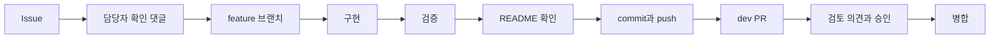

# 작업 흐름

## 브랜치

| 브랜치 | 역할 | 변경 방식 |
|---|---|---|
| `main` | 안정적으로 사용할 수 있는 코드 | `dev → main` PR만 허용 |
| `dev` | 완료된 기능의 통합과 검증 | feature PR로 변경 |
| `feature/*` | Issue별 작업 | 최신 `dev`에서 생성 |

## 업무 할당 확인

- 팀장은 Jira와 GitHub Issue로 업무를 분장합니다. Jira에서는 작업명·담당자·일정·상태를,
  GitHub Issue에서는 목적·상세 작업·완료 조건·제외 범위와 개발 논의를 확인합니다.
- 담당자는 업무를 시작하기 전에 Jira와 GitHub Issue를 모두 확인합니다.
- 다른 의견이나 개선 제안이 있으면 GitHub Issue에 근거와 함께 댓글로 남깁니다.
- 별도 의견이 없더라도 `확인했습니다. 해당 내용대로 진행하겠습니다.`와 같은 댓글로 확인과
  진행 의사를 남깁니다. 모든 업무 할당에는 담당자의 확인 기록이 필요합니다.

## 작업 기준

1. Issue의 목적·작업·완료 조건을 확인합니다.
2. `feature/<issue-number>-<description>` 브랜치를 만듭니다.
3. 구현 후 관련 검사를 실행합니다.
4. README에서 기능·구조·실행 방법·환경 변수 변경을 반영합니다.
5. 영어 commit을 만들고 branch를 push합니다.
6. 한국어 PR에 변경·위험·영향·검증 결과를 기록합니다.

README 변경이 없으면 PR에 이유를 한 줄로 남깁니다. 최초 빈 `main` commit은 저장소 초기화를 위한 한 번의 예외이며 이후 직접 push는 금지합니다.

## Jira와 GitHub 기록

- Jira에는 작업명·담당자·시작일·마감일·상태를 간단히 기록합니다.
- GitHub Issue에는 목적·세부 작업·완료 조건·제외 범위와 개발 논의를 기록합니다.
- GitHub Issue 제목은 `[IPGO-77] 작업명`처럼 Jira 키를 포함합니다.
- feature PR은 제목·본문·branch 중 한 곳 이상에 Jira 키를 포함해 PR 생성 시 Jira를 진행 상태로
  바꿀 수 있게 합니다.
- `dev → main` PR 제목에는 운영 배포 후 완료할 Jira 키를 모두 포함합니다. 운영 workflow는
  `main`의 merge commit 메시지에서 키를 읽으므로 PR 본문에만 적으면 완료 처리되지 않습니다.
- PR 승인과 병합, Jira 스프린트 배정은 사람이 수행합니다.

### 담당자 배정

- AI 작업이 미배정이면 이석형(`tjrgud3000-ops`), 서버 작업이 미배정이면
  정무영(`bose9029`)을 기본 담당자로 검토합니다.
- 기존 담당자가 있으면 영역 기본 담당자로 바꾸지 않습니다.
- `[공통]`, `[연동]`, `[화면]`처럼 영역이 겹치는 작업은 기본 담당자를 자동 적용하지 않고
  작업 범위를 확인해 수동으로 정합니다.
- Jira와 GitHub에 서로 다른 담당자가 있으면 자동으로 한쪽을 덮어쓰지 않고 불일치 원인을
  확인한 뒤 수동으로 정리합니다.

여러 작업을 한 번에 배포하면 PR 제목 앞에 `[IPGO-73][IPGO-74]`처럼 완료 대상을 모두 적습니다.
운영 배포 후 Jira와 GitHub Issue가 닫히지 않았다면 GitHub Issue를 수동으로 닫고 Jira 전환
workflow가 성공했는지 확인하거나 Jira를 완료로 바꾼 뒤 정기 동기화를 확인합니다.

## PR 검토와 승인

- 다른 팀원의 PR을 변경 내용 확인 없이 승인하지 않습니다.
- 변경된 코드와 작업 내용, 연결된 Issue, 완료 조건, 테스트 결과와 다른 기능에 미치는 영향을
  확인합니다.
- 검토 후에는 반드시 의견을 남깁니다. 문제가 없으면
  `변경사항과 관련 Issue를 확인했으며, 특이사항 없습니다.`와 같이 확인한 범위를 기록합니다.
- 수정이 필요하면 수정할 부분과 이유를 구체적으로 적습니다.
- PR 승인은 실제 검토와 의견 기록을 마친 뒤 진행합니다.

## Issue 등록과 의사결정 기록

- 새 문제나 작업을 전달하기 전에 GitHub Issues에서 같거나 비슷한 Issue가 있는지 검색합니다.
- ChatGPT, Claude 등 사용하는 LLM 서비스로 기존 Issue와의 연관성·중복 여부를 검토할 수 있지만,
  검색 결과와 실제 Issue 내용을 함께 확인해 최종 판단합니다.
- 기존 Issue와 같은 문제라면 새 Issue를 만들지 않고 기존 Issue에 현재 상황과 추가 정보를
  댓글로 남깁니다. 다른 문제일 때만 새 Issue를 만들고 관련 내용을 공유합니다.
- 구두나 메신저에서 결정한 내용도 필요한 경우 GitHub Issue 또는 PR에 다시 기록합니다.
- 모든 업무는 `확인 → 검토 → 의견 기록 → 진행 또는 승인` 순서로 처리합니다.

## 브랜치 보호

### dev

- PR을 통해서만 변경
- 필수 승인 수 0건
- 미해결 리뷰 대화가 있으면 병합 금지
- 자동 승인·자동 병합, force push와 branch 삭제 금지

### main

- 작성자 외 팀원 1명 승인 필수
- 새 commit이 추가되면 기존 승인 무효화
- 미해결 리뷰 대화가 있으면 병합 금지
- 관리자 우회, force push와 branch 삭제 금지

## 배포 연결

| 반영 branch | 실행 시점 | 결과 |
|---|---|---|
| `dev` | feature PR을 사람이 병합한 뒤 | Vercel Preview build와 개발 고정 주소 갱신 |
| `main` | `dev → main` PR을 승인받아 사람이 병합한 뒤 | Production 후보 build·smoke test·승격 |

배포 주소, 설정 이름, 검증과 복구 절차는 [자동화 운영](../automation.md)을 따릅니다.
