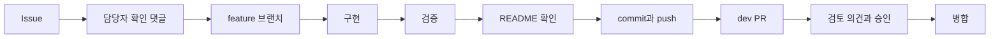

# 작업 흐름

## 브랜치

| 브랜치 | 역할 | 변경 방식 |
|---|---|---|
| `main` | 안정적으로 사용할 수 있는 코드 | `dev → main` PR만 허용 |
| `dev` | 완료된 기능의 통합과 검증 | feature PR로 변경 |
| `feature/*` | Issue별 작업 | 최신 `dev`에서 생성 |

## 업무 할당 확인

- 팀장은 Jira와 GitHub Issue로 업무를 분장합니다. Jira에서는 작업명·담당자·일정·상태를,
  GitHub Issue에서는 목적·상세 작업·완료 조건·제외 범위와 개발 논의를 확인합니다.
- 담당자는 업무를 시작하기 전에 Jira와 GitHub Issue를 모두 확인합니다.
- 다른 의견이나 개선 제안이 있으면 GitHub Issue에 근거와 함께 댓글로 남깁니다.
- 별도 의견이 없더라도 `확인했습니다. 해당 내용대로 진행하겠습니다.`와 같은 댓글로 확인과
  진행 의사를 남깁니다. 모든 업무 할당에는 담당자의 확인 기록이 필요합니다.

## 작업 기준

1. Issue의 목적·작업·완료 조건을 확인합니다.
2. `feature/<issue-number>-<description>` 브랜치를 만듭니다.
3. 구현 후 관련 검사를 실행합니다.
4. README에서 기능·구조·실행 방법·환경 변수 변경을 반영합니다.
5. 영어 commit을 만들고 branch를 push합니다.
6. 한국어 PR에 변경·위험·영향·검증 결과를 기록합니다.

README 변경이 없으면 PR에 이유를 한 줄로 남깁니다. 최초 빈 `main` commit은 저장소 초기화를 위한 한 번의 예외이며 이후 직접 push는 금지합니다.

## 구현·검증 절차

1. 사용자 흐름을 한 문장으로 정하고 `git status`로 기존 변경을 보존한다. `rg`로 요청·응답 칸,
   변환 함수·렌더 함수·관련 테스트만 먼저 찾는다. 큰 파일/README/로그 전체를 여러 번 출력하지 않는다.
   확인한 API 계약·근거는 작업 메모에 한 번 남기며 미조회 실사용 결과를 추정하지 않는다.
2. 다음 연결 지도를 시작점으로 사용하되 줄 번호 대신 실제 심볼을 찾는다.

   | 흐름 | 코드 | 우선 확인할 테스트 |
   |---|---|---|
   | 업로드 결과→화면 | `features/upload/model/uploadApi.ts` → `pages/UploadResultPage.tsx` | uploadApi·UploadResultPage |
   | 업로드 상태→상단 안내 | uploadApi → `shared/api/CalculationProvider.tsx` | CalculationProvider |
   | 상품 응답→추이 | `features/sku/model/skuApi.ts` → `pages/SkuPage.tsx`의 TrendChart | skuApi·SkuPage |

   위 경로는 `src/` 기준이며 pages 경로는 같은 feature 아래다. 환경·라이브러리·배포 문서는
   해당 경계에 필요할 때만 읽는다. 의존성 설치는 첫 준비나 lockfile 변경 때만 수행한다.
3. 관련 테스트에 정상/빈 값/기존 응답 호환·실패 경계를 포함한다. SVG 내부 `<title>`은
   `getByTitle`이 항상 찾는다고 가정하지 않고 실제 DOM·사용자에게 노출되는 글자/역할로 확인한다.
   브라우저 합성 응답은 현재 API 계약과 일치시킨다. 주변 시나리오/인사이트/입고 예정량 등
   기존 GET 누락도 실패로 처리하며, 실제 서버 호출이나 무조건 빈 성공 응답으로 숨기지 않는다.
4. 편집이 끝나면 수정 파일만 명시해 Prettier를 실행하고 관련 테스트의 실패를 해결한다.
   저장소 전체 자동 포맷으로 다른 변경을 섞지 않는다. 이후 `npm run verify:local` 한 번으로
   **기존 ci:check 전체** → build:ci → verify:browser를 실행한다. 포맷·검증 도구·타입 검사는
   ci:check 안에서 각각 한 번 실행하고 통과한 뒤 번들을 만든다.
   CI의 기존 전체 앱·자동화 검사를 줄이거나 skip하지 않고 검증 도구 검사도 포함한다.
   브라우저 검사는 화면 연결 IPGO-196의 선행 병합 후 사용한다.
5. 검사 실행 중 코드/fixture/README를 바꾸지 않는다. 문서 초안은 저장소 밖 보호 메모에서
   준비한다. 소스 fingerprint가 도중에 바뀌면 모든 단계가 통과해도 최종 성공으로 남기지 않는다.
   상태는 출력된 `summary.json`의 새 단계만 확인하고 같은 원문/검사를 반복 조회하지 않는다.
6. 완료 후 로그의 종료 상태, PC/모바일 캡처, 실제 확인 범위·미검증 경계를 한 번에 검토하고
   결과를 정리한다. 실패 단계만 원인을 조사하며 무작정 재실행하지 않는다. 재검사는 변경·실패·
   해결하지 못한 우려에 필요한 범위로 수행하고, 원래 실패 로그를 후속 성공으로 덮어쓰지 않는다.
   전체 검증을 다시 실행할 때도 결과 폴더는 항상 새로 만든다.
7. 실제 기능 변경·로컬 합성 검증·실사용 효과·원격 게시/배포를 구분한다. 단축 효과는 다음
   비슷한 실제 업무에서만 비교하며 별도 벤치마크/시험 배포를 만들지 않는다. Issue/Jira/PR·
   사람의 병합·외부 공개/배포 승인 규칙은 그대로 유지한다. 검증 명령은 배포를 수행하지 않는다.

### 실행 환경과 기록 준비

- 실제 작업 worktree 최상위에서 실행하고 그 경로를 작업 패킷에 고정한다. `package.json`의
  Node/npm 범위와 lockfile·기존 설치 성공 근거를 대조한다. 같은 worktree의 설치가 유효하면
  다시 설치하지 않고, lockfile·실행 환경 변경이나 의존성 누락 때만 `npm ci`를 다시 수행한다.
- 독립 CLI를 사용할 때 구현·검사·Git 쓰기·앱 첨부를 맡을 실행 주체를 준비 때 정한다.
  파일 수정 권한과 worktree의 공용 Git 디렉터리 쓰기 권한은 별개다. 기존 `index.lock`
  읽기 전용 오류나 첨부 도구 미노출 근거가 있으면 해당 마감만 권한 있는 부모가 맡는다.
  구현 전체를 다시 실행하거나 Git 잠금 삭제·권한 확대·샌드박스 우회로 해결하지 않는다.
- GitHub 플러그인은 읽기를 우선한다. 같은 계정·저장소·작업 유형에서 최근 확인한 쓰기 403은
  원문과 범위를 재사용해 승인된 해당 쓰기만 기존 GitHub CLI로 보완한다. 읽기 실패나
  앱 API의 403과 혼동하지 않으며, 계정·권한·연결이 바뀌면 지원 여부를 다시 확인한다.
  쓰기 직전 head/환경/승인과 변경 후 플러그인 독립 조회는 유지한다.
- CLI 인자는 현재 버전의 지원 근거를 재사용한다. `gh pr checks --json` 미지원 경로에서는
  `gh pr view --json statusCheckRollup`을 쓰고, `gh pr edit`의 폐기된 `projectCards` 조회 오류는
  승인된 PR 수정만 `gh api --method PATCH`와 본문 파일로 보완한다. 본문을 셸 코드에 끼워 넣지 않는다.
- 과거 timeout·exit143처럼 원인 미확인 종료는 원문과 완료된 증거를 보존해 인계한다.
  후속 성공으로 첫 실패를 바꾸거나 원인 확인 없이 전체 재실행·시간 제한 확대를 하지 않는다.

### 결과 정본과 원본 보존

- 준비 패킷에는 목표·영향 파일·검사 명령·승인 경계·비교 기준과 한계만 적는다.
  완료 설명과 사람의 검토 결론은 기존 `completion.json` 한 곳에 모으고, 같은 설명의
  `report.md`·`review.txt`·별도 검토 요약을 추가하지 않는다. 기존 과거 파일은 그대로 보존한다.
- 검증기의 `summary.json`은 검사 결과, 작업 원장의 `summary.json`은 단계 시간 정본이다.
  원문 로그·브라우저 `browser-result.json`/캡처·실패·승인·공개 PR 리뷰는 각각의 증거로 보존하고
  완료 정본에서 경로·관측 범위로 연결한다. 서로 다른 증거를 합치거나 검사 수·시간을 중복 합산하지 않는다.
- 상태 문서는 결과·검증 한계·정본 링크 세 줄 이내로 연결한다. PR에는 검토에 필요한 변경과
  검증 결과만 남기고, 긴 시간표·로컬 완료 설명을 Issue/PR/Jira/인수인계마다 복제하지 않는다.
  자동 검사 통과와 사람의 검토 완료·전체 업무 완료는 구분한다.

## Jira와 GitHub 기록

- Jira에는 작업명·담당자·시작일·마감일·상태를 간단히 기록합니다.
- GitHub Issue에는 목적·세부 작업·완료 조건·제외 범위와 개발 논의를 기록합니다.
- GitHub Issue 제목은 `[IPGO-77] 작업명`처럼 Jira 키를 포함합니다.
- feature PR은 제목·본문·branch 중 한 곳 이상에 Jira 키를 포함해 PR 생성 시 Jira를 진행 상태로
  바꿀 수 있게 합니다.
- `dev → main` PR 제목에는 운영 배포 후 완료할 Jira 키를 모두 포함합니다. 운영 workflow는
  `main`의 merge commit 메시지에서 키를 읽으므로 PR 본문에만 적으면 완료 처리되지 않습니다.
- PR 승인과 병합, Jira 스프린트 배정은 사람이 수행합니다.

### 담당자 배정

- AI 작업이 미배정이면 이석형(`tjrgud3000-ops`), 서버 작업이 미배정이면
  정무영(`bose9029`)을 기본 담당자로 검토합니다.
- 기존 담당자가 있으면 영역 기본 담당자로 바꾸지 않습니다.
- `[공통]`, `[연동]`, `[화면]`처럼 영역이 겹치는 작업은 기본 담당자를 자동 적용하지 않고
  작업 범위를 확인해 수동으로 정합니다.
- Jira와 GitHub에 서로 다른 담당자가 있으면 자동으로 한쪽을 덮어쓰지 않고 불일치 원인을
  확인한 뒤 수동으로 정리합니다.

여러 작업을 한 번에 배포하면 PR 제목 앞에 `[IPGO-73][IPGO-74]`처럼 완료 대상을 모두 적습니다.
운영 배포 후 Jira와 GitHub Issue가 닫히지 않았다면 GitHub Issue를 수동으로 닫고 Jira 전환
workflow가 성공했는지 확인하거나 Jira를 완료로 바꾼 뒤 정기 동기화를 확인합니다.

## PR 검토와 승인

- 다른 팀원의 PR을 변경 내용 확인 없이 승인하지 않습니다.
- 변경된 코드와 작업 내용, 연결된 Issue, 완료 조건, 테스트 결과와 다른 기능에 미치는 영향을
  확인합니다.
- 검토 후에는 반드시 의견을 남깁니다. 문제가 없으면
  `변경사항과 관련 Issue를 확인했으며, 특이사항 없습니다.`와 같이 확인한 범위를 기록합니다.
- 수정이 필요하면 수정할 부분과 이유를 구체적으로 적습니다.
- PR 승인은 실제 검토와 의견 기록을 마친 뒤 진행합니다.

## Issue 등록과 의사결정 기록

- 새 문제나 작업을 전달하기 전에 GitHub Issues에서 같거나 비슷한 Issue가 있는지 검색합니다.
- ChatGPT, Claude 등 사용하는 LLM 서비스로 기존 Issue와의 연관성·중복 여부를 검토할 수 있지만,
  검색 결과와 실제 Issue 내용을 함께 확인해 최종 판단합니다.
- 기존 Issue와 같은 문제라면 새 Issue를 만들지 않고 기존 Issue에 현재 상황과 추가 정보를
  댓글로 남깁니다. 다른 문제일 때만 새 Issue를 만들고 관련 내용을 공유합니다.
- 구두나 메신저에서 결정한 내용도 필요한 경우 GitHub Issue 또는 PR에 다시 기록합니다.
- 모든 업무는 `확인 → 검토 → 의견 기록 → 진행 또는 승인` 순서로 처리합니다.

## 브랜치 보호

### dev

- PR을 통해서만 변경
- 필수 승인 수 0건
- 미해결 리뷰 대화가 있으면 병합 금지
- 자동 승인·자동 병합, force push와 branch 삭제 금지

### main

- 작성자 외 팀원 1명 승인 필수
- 새 commit이 추가되면 기존 승인 무효화
- 미해결 리뷰 대화가 있으면 병합 금지
- 관리자 우회, force push와 branch 삭제 금지

## 배포 연결

| 반영 branch | 실행 시점 | 결과 |
|---|---|---|
| `dev` | feature PR을 사람이 병합한 뒤 | Vercel Preview build와 개발 고정 주소 갱신 |
| `main` | `dev → main` PR을 승인받아 사람이 병합한 뒤 | Production 후보 build·smoke test·승격 |

배포 주소, 설정 이름, 검증과 복구 절차는 [자동화 운영](../automation.md)을 따릅니다.
